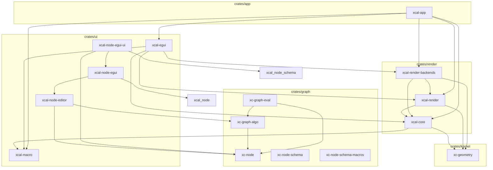

# Architecture

> **本文件的『依赖图 / 分层 / 合规校验』由 `cargo-workspace-analyzer` 自动生成。**
> 修改 `Cargo.toml` 后重新运行 `cargo-workspace-analyzer -d .` 即可刷新。
> **不要手动编辑下方自动生成部分**——手写内容（设计原则、待决问题）请放在末尾『## 设计说明』。

## 分层总览

| 层 | 路径 | 前缀 | 职责 |
|---|---|---|---|
| kernel | `crates/kernel/` | `xc-` | 纯计算/数据内核（无 egui、无渲染、无领域）|
| graph  | `crates/graph/`  | `xc-` | 图论 + 节点结构契约（NodeSpec/Property/DynamicObject）|
| render | `crates/render/` | `xcal-` | 渲染抽象 + 后端（含 ECS/场景）|
| ui     | `crates/ui/`     | `xcal-` | egui 前端 + 编辑器 + proc-macro |
| app    | `crates/app/`    | `xcal-` | 组装 / 可执行 |

## 依赖图

依赖方向自上而下：`kernel → graph → render → ui → app`，反向禁止。



## 合规校验

| 规则 | 状态 | 说明 |
|---|---|---|
| NoReverseDependency | ✅ 通过 | 无 xc-* → xcal-* / egui / wgpu 生产依赖 |
| NoAppDependency | ✅ 通过 | 无 xcal-* crate 依赖 xcal-app |
| NoGraphDomainTypes | ✅ 通过 | crates/graph 无领域类型引用 |
| NoCycles | ✅ 通过 | 生产依赖为 DAG（dev-deps 不计入） |

**依赖分析（cargo-workspace-analyzer 输出）：**

| Package | FanIn | FanOut | Instability |
|---------|-------|--------|-------------|
| xcal-app | 0 | 5 | 1.00 |
| xcal-egui | 1 | 4 | 0.80 |
| xcal-node-egui | 1 | 2 | 0.67 |
| xc-node-schema | 1 | 2 | 0.67 |
| xcal-node-editor | 1 | 2 | 0.67 |
| xc-graph-eval | 0 | 1 | 1.00 |
| xcal-node-egui-ui | 0 | 3 | 1.00 |
| xc-node | 6 | 0 | 0.00 |
| xcal-core | 4 | 2 | 0.33 |
| xc-graph-algo | 1 | 1 | 0.50 |
| xcal-render | 3 | 2 | 0.40 |
| xcal-render-backends | 2 | 3 | 0.60 |
| xcal-macro | 3 | 0 | 0.00 |
| xc-geometry | 3 | 0 | 0.00 |
| xc-node-schema-macros | 1 | 0 | 0.00 |

Instability = FanOut / (FanIn + FanOut)；0 = 底层稳定，1 = 高层易变。

---

## 设计说明（手写区，不被脚本覆盖）

### 调度流水线

**2D**

```
Input → LogicUpdate → SceneSync → Prepare → RenderCommit → FrameEnd
 TimeUpdate  ControlPanel  ViewRectUpdate  GridBuild   SceneRecord  RenderSubmit
```

**3D**

```
SceneSync:  OrbitApply (R=TimeState, W=())
RenderCommit: SceneRecord3D (W=DrawQueue3D)
FrameEnd:    RenderSubmit3D (R=EguiFrameContext, DrawQueue3D, ViewRect, W=())
```

3D 合成方式：`ui.painter_at(central_rect).add(Shape::Callback(...))`，不使用 `Order::Background`，clip rect 自动限制到中央视口。

### 技术约束

- Rust edition 2024
- hecs 0.11 为唯一 ECS 后端，不替换
- wgpu 30 / egui 0.36 / eframe 0.36
- glam 0.33：NDC Z∈[0,1]，用 `glam::camera::rh::proj::directx::` 系列
- Transform2D traits 由 `xcal_macro::Transform2DInto` 过程宏派生
- System trait 关联类型 `Reads` / `Writes` 无默认值（stable Rust 不支持 associated type defaults）
- `ErasedSystem` 为 object-safe 运行时 trait，`Box<dyn ErasedSystem>` 存储
- Scheduler 每阶段独立 CommandBuffer，阶段结束 flush
- ExecutorContext `resources` 字段私有，仅通过 `get<T>()` / `get_mut<T>()` 访问
- DrawQueue 使用稳定排序保留同 ZIndex 的插入顺序

### cargo-archtest 适配状态

`cargo-archtest v0.2.3` 的架构模型是「单 crate 内按 `src/` 子目录分层」，
不适用于本 workspace 的「workspace 级 crate 分层」。当前 CI 流程：
- `cargo check --workspace --all-targets`（编译自然拦截反向依赖）
- `cargo-workspace-analyzer -d .`（依赖分析 + 循环检测）

待上游提供 workspace 模式后补充 `cargo archtest` 步骤。
