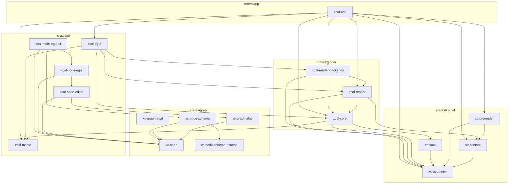

# Architecture

> **本文件的『依赖图 / 分层 / 合规校验』由 `cargo-workspace-analyzer` 自动生成。**
> 修改 `Cargo.toml` 后重新运行 `cargo-workspace-analyzer -d .` 即可刷新。
> **不要手动编辑下方自动生成部分**——手写内容（设计原则、待决问题）请放在末尾『## 设计说明』。

## 分层总览

| 层 | 路径 | 前缀 | 职责 |
|---|---|---|---|
| kernel | `crates/kernel/` | `xc-` | 纯计算/数据内核（无 egui、无渲染；可含通用能力领域，如几何、排版）|
| graph  | `crates/graph/`  | `xc-` | 图论 + 节点结构契约（NodeSpec/Property/DynamicObject）|
| render | `crates/render/` | `xcal-` | 渲染抽象 + 后端（含 ECS/场景）|
| ui     | `crates/ui/`     | `xcal-` | egui 前端 + 编辑器 + proc-macro |
| app    | `crates/app/`    | `xcal-` | 组装 / 可执行 |

## 依赖图

依赖方向自上而下：`kernel → graph → render → ui → app`，反向禁止。



## 合规校验

| 规则 | 状态 | 说明 |
|---|---|---|
| NoReverseDependency | ✅ 通过 | 无 xc-* → xcal-* / egui / wgpu 生产依赖 |
| NoAppDependency | ✅ 通过 | 无 xcal-* crate 依赖 xcal-app |
| NoGraphDomainTypes | ✅ 通过 | crates/graph 无领域类型引用 |
| NoCycles | ✅ 通过 | 生产依赖为 DAG（dev-deps 不计入） |

**依赖分析（cargo-workspace-analyzer 输出；本次数据由 `cargo metadata` 等价重算，见文末说明）：**

| Package | FanIn | FanOut | Instability |
|---------|-------|--------|-------------|
| xcal-app | 0 | 8 | 1.00 |
| xcal-node-egui-ui | 0 | 3 | 1.00 |
| xc-graph-eval | 0 | 1 | 1.00 |
| xcal-egui | 1 | 4 | 0.80 |
| xcal-node-egui | 1 | 2 | 0.67 |
| xc-node-schema | 1 | 2 | 0.67 |
| xcal-node-editor | 1 | 2 | 0.67 |
| xc-prerender | 1 | 2 | 0.67 |
| xcal-render-backends | 2 | 3 | 0.60 |
| xcal-render | 3 | 3 | 0.50 |
| xc-graph-algo | 1 | 1 | 0.50 |
| xc-time | 1 | 1 | 0.50 |
| xcal-core | 4 | 3 | 0.43 |
| xc-content | 3 | 1 | 0.25 |
| xc-node-schema-macros | 1 | 0 | 0.00 |
| xc-node | 6 | 0 | 0.00 |
| xc-geometry | 7 | 0 | 0.00 |
| xcal-macro | 3 | 0 | 0.00 |

Instability = FanOut / (FanIn + FanOut)；0 = 底层稳定，1 = 高层易变。

---

## 设计说明（手写区，不被脚本覆盖）

### 调度流水线

**2D**

```
Input → LogicUpdate → SceneSync → Prepare → RenderCommit → FrameEnd
 TimeUpdate  ControlPanel  ViewRectUpdate  GridBuild   SceneRecord  RenderSubmit
```

**3D**

```
SceneSync:  OrbitApply (R=TimeState, W=())
RenderCommit: SceneRecord3D (W=DrawQueue3D)
FrameEnd:    RenderSubmit3D (R=EguiFrameContext, DrawQueue3D, ViewRect, W=())
```

3D 合成方式：`ui.painter_at(central_rect).add(Shape::Callback(...))`，不使用 `Order::Background`，clip rect 自动限制到中央视口。

### 技术约束

- Rust edition 2024
- hecs 0.11 为唯一 ECS 后端，不替换
- wgpu 30 / egui 0.36 / eframe 0.36
- glam 0.33：NDC Z∈[0,1]，用 `glam::camera::rh::proj::directx::` 系列
- Transform2D traits 由 `xcal_macro::Transform2DInto` 过程宏派生
- System trait 关联类型 `Reads` / `Writes` 无默认值（stable Rust 不支持 associated type defaults）
- `ErasedSystem` 为 object-safe 运行时 trait，`Box<dyn ErasedSystem>` 存储
- Scheduler 每阶段独立 CommandBuffer，阶段结束 flush
- ExecutorContext `resources` 字段私有，仅通过 `get<T>()` / `get_mut<T>()` 访问
- DrawQueue 使用稳定排序保留同 ZIndex 的插入顺序

### 两阶段内容管线（xc-content / xc-prerender）

```
源码字符串 → xc-prerender（engine: typst [feature] / placeholder）
           → xc-content::ContentIR（StyledPath + fill/stroke + Span 锚点，pt，Y-up）
           → xcal-render::ir_to_draw_cmds（scale = 目标字号 / nominal_font_size，
                                          Shape2D::Path + Style2D + Transform2D）
           → xcal-app::formula（接线桥：flatten_subpaths + apply_point
                               → 旧 Path 组件 + StrokeSolid，每个子轮廓一条实体）
```

- **铁律**：`typst` 仅允许出现在 `xc-prerender` 且 feature-gated；`xcal-render`
  只依赖 `xc-content`（验收：`cargo tree -p xcal-render` 无 typst）。
- 锚点两级映射：`Glyph.span` → `WorldExt::range`（main source 字节区间）
  → 原始归一化源码 `find`；归一化/哈希统一由 `xc-content` 实现，保证跨引擎一致。
- **消费侧接线**（`crates/app/xcal-app/src/formula.rs`）：复用 `ir_to_draw_cmds` 的
  缩放/平移，不另写变换；用 `Path2D::flatten_subpaths` 按子轮廓分组，每个子轮廓
  单独 spawn 一条 `(Path, StrokeSolid)`（多轮廓字形 `o`/`B`/`8` 因此不会出现横穿
  字形内部的桥接线）。零 System 改动——复用现有 `record_scene` 的 `(Path, StrokeSolid)`
  分支。
- **字号解耦**：`FormulaSpec.nominal_font_size`（Typst 编译标称字号，默认 12.0）决定
  曲线提取精度与 IR 本地点尺度；`FormulaSpec.font_size` 是目标显示大小，仅经
  `ir_to_draw_cmds` 的 `scale = target / nominal` 生效。展平容差是相对标称尺度的绝对值，
  故显示尺寸缩小不会放大折线误差。
- **空心字口径（当前）**：旧管线 Fill 分支用 `convex_polygon`，非凸字形会被画成凸包，
  因此公式暂走 Stroke（轮廓）路径；实心填充待 S3 引入三角化后接管
  （挂在 `CustomShapeData::to_triangles`）。
- feature：`xcal-app` 默认 `typst`；`--no-default-features` 时回退 `placeholder` 引擎
  （显示方块，链路仍可跑通）。

### S1 插值内核与形变（路线甲）

```
xc-geometry：Lerp / arc_lengths / resample_arc_length / Path2D::morph(+morph_points) / transformed
xc-time    ：Easing + AnimValue::Path + Curve::{Morph, PathMorph, Keyframes}
xc-content ：pair_by_anchor（语义配对，按源码锚点）
xcal-core  ：MorphShape 组件 + BindingTarget::MorphT + MorphApplySystem（SceneSync）
```

- **路线甲**：`xc-time` 依赖 `xc-geometry`（插值原语），但**不得**依赖 `xc-content`
  （语义配对知识留外层）。验收：`cargo tree -p xc-time | grep -c xc-content` = 0。
- 对齐按**弧长**（非索引）：`flatten` 输出点分布不均，按索引配对会让直线段被拉伸、
  曲线段被压缩，形变过程"抽动"。
- 输出顶点数**恒为 `samples`**（默认 128）→ 稳定开销，与输入复杂度无关。
- **场景接缝**：`MorphShape{from, to, t}` 只写 `t`（经 `BindingTarget::MorphT`），
  `MorphApplySystem` 每帧把 `Path2D::morph_points` 的结果写进同实体的 `Path`
  —— render 层复用现有 `record_scene`，零录制改动。from/to 不每帧重建
  （为 S3 上 GPU 预留：上传一次 + 每帧一个 float）。
- **语义配对（S1b）**：`xc_content::pair_by_anchor` 按源码 `Span` 锚点配对
  （`x^2 → x^3` 的 `x` 配到 `x`，而非按位置配到 `3`）；单侧存在 → 淡入/淡出
  （退化为包围盒中心的一个点）；无锚点 → 退化为索引配对。
- 已知限制：旋转对齐（起点不一致会"绕圈"，原型期约定起点对齐）、
  Color 线性空间非感知均匀、当前为 CPU 插值。

### 呈现层度量空间（MeasureSpace）

让"宽度属于哪个空间"成为**可声明**的属性（仅 2D 描边宽度；不含 3D）。

**判断标准**：这个度量是**被观测对象的属性**，还是**观测工具的属性**？
- 被观测对象的属性（有数学含义的粗线段、公式描边）→ `MeasureSpace::World`：随缩放变化；
- 观测工具的属性（网格线、坐标轴）→ `MeasureSpace::Screen`：不随缩放变化；
- 需要保底时 → `MeasureSpace::WorldWithMinPx(min)`：世界单位但钳到最小像素。

属性分空间，不是对象分空间——同一个对象的不同属性可属不同空间
（向量箭头的**长度**是世界，**粗细**是屏幕）。

```
Stroke2D.space / StrokeSolid.space / Style2D.space（声明）
        │
        ▼
xc_geometry::resolve_width(width, space, scale)   ← 唯一换算入口
        │
        ▼
xcal-render::record_scene（从 camera.scale 取值）  ← 唯一换算点
        │
        ▼
DrawQueue（Style::Stroke.width 已是屏幕像素）
```

- **换算点必须唯一**：世界宽度需在**几何变换之前**乘一次 `scale`；若某些地方乘过、
  某些没乘，会出现"网格线在 2D 里对、3D 里错"这类不一致。项目中 `resolve_width`
  的非测试调用只有 `crate::draw` 的 `ResolveStyle for StrokeSolid` 一处。
- 默认 `MeasureSpace::Screen`（`StrokeSolid::new` / `Stroke2D::new` 两参构造），
  既有调用点行为不变；显式声明用 `new_in(...)`。
- 公式描边：`ir_to_draw_cmds` 把宽度乘 `target / nominal_font_size`（与几何同系数）
  换算为世界单位并标 `World` —— 否则 1.0pt 会被当成 1.0 世界单位，在 scale=40 下
  渲染成 40px。
- 与 S3 无关：`width / space / 当前 scale` 是 **per-draw uniform**，不碰顶点格式；
  只有到 S3 需要缓存几何时才把换算挪进 shader（接口不变）。

### S3 2D 渲染统一（M0 / S3-0 / S3-1）

**M0 图元体系迁移**：2D 载荷统一为 `Shape2D` / `Style2D`（旧 `Shape` / `Style` 枚举删除）。
`Painter2D::paint(&self, &Shape2D, &Style2D)`；`DrawQueue::push(DrawCommand { z, shape, style })`
+ `ensure_sorted()`（`Vec::sort`，稳定）+ `execute(&painter)`。迁移后画面不变。

**S3-0 三角化适配层**（`xcal-render::tessellate`，纯 CPU / headless，无 feature 门控）：
`Shape2D + Transform2D + Style2D` → `Vec<Tessellation2D>`，顶点**严格**符合顶点契约
（`VertexLayout::standard`，stride 20，三槽 position/attrib0/attrib1；
`Vertex2D { position, normal, side }`，`size == 20` 编译期断言）。三角化用
`lyon_tessellation` 1.0，不自研；`tolerance_for_scale(scale) = (0.25/scale).clamp(1e-4, 1.0)`。

**S3-1 wGPU 2D 后端**（`xcal-render-backends::wgpu_2d`）：离屏 `Rgba8Unorm`（非 sRGB，
存 gamma）+ MSAA 4x。`finish_frame` 流程 = 稳定排序 → 逐项三角化 → 顶点哈希缓存
（`ResourceCache<()>` + `DeferredDestroyer`）→ `UniformArena`（**复用 `wgpu_3d`**，
256B 对齐 dynamic offset）→ 离屏绘制；`composite` 用哨兵 `COMPOSITE_QUAD` 贴回主 pass。
`Layer2DCallback`（egui-wgpu）经 `prepare` / `paint` 与之对接。
**运行期开关** `UiConfig::gpu_2d`（默认 off）在 `xcal-egui::EguiSceneHost::present` 二选一：
`EguiPainter` CPU 回放 ↔ `Layer2DCallback` GPU 路径（旧管线退役属 S3-4）。

**egui-wgpu 回调 viewport 契约（踩坑记录）**：egui-wgpu 处理 `Primitive::Callback` 时会把
render pass viewport 设为**回调自身矩形**（`set_viewport`，到下一个 primitive 才复位）。
即回调内 NDC `[-1,1]²` 对应回调矩形本身——合成四边形必须写死全 NDC 盒，不得用整屏尺寸
把视口像素矩形换算成裁剪坐标（否则视口被**二次应用** → 2D 视图在 X 方向被压扁）。
回归测试 `composite_lands_inside_scoped_viewport_on_real_device` 在旧实现下必然失败。

### cargo-archtest 适配状态

`cargo-archtest v0.2.3` 的架构模型是「单 crate 内按 `src/` 子目录分层」，
不适用于本 workspace 的「workspace 级 crate 分层」。当前 CI 流程：
- `cargo check --workspace --all-targets`（编译自然拦截反向依赖）
- `cargo-workspace-analyzer -d .`（依赖分析 + 循环检测）

> 备注（2026-09-03）：本次刷新时 `cargo-workspace-analyzer` 在本机连续
> 挂起（CPU 空转、无文件输出；正常时会生成 `workspace-analyzer.mmd` /
> `architecture.json`），故图与 FanIn/FanOut 表改用
> `cargo metadata --format-version 1`（仅生产依赖，`kind != dev`）等价重算。
> 工具恢复后重跑 `cargo-workspace-analyzer -d .` 即可覆盖回自动产物。
>
> 备注（2026-10-13）：S1 引入 `xc-time → xc-geometry` 边后按同一口径再次重算
> FanIn/FanOut（`xc-time` FanOut 0→1、`xc-geometry` FanIn 5→7、`xcal-app` FanOut 5→8）。
>
> 备注（2026-10-15）：依赖图与 `workspace-analyzer.mmd` 按同一 `cargo metadata` 口径
> 手工补齐（工具仍不可用），合计补 9 条边：
> - 本文件图区：修正 `xcal_node_egui → xc_node`、`xcal_node_egui_ui → xc_node_schema`
>   两处前缀笔误，并补 `xc-node-schema → xc-node` / `→ xc-node-schema-macros`（2 条）；
> - `workspace-analyzer.mmd`：补 `xc-prerender → xc-content` / `→ xc-geometry`、
>   `xc-time → xc-geometry`、`xcal-app → xc-content` / `→ xc-geometry` / `→ xc-prerender`、
>   `xcal-render → xc-content`（7 条，29 → 36）。
>
> FanIn/FanOut 表经复核无需改动。工具恢复后重跑 `cargo-workspace-analyzer -d .`
> 即可覆盖回自动产物。

待上游提供 workspace 模式后补充 `cargo archtest` 步骤。
