# Architecture

> **本文件的『依赖图 / 分层 / 合规校验』由 `cargo-workspace-analyzer` 自动生成。**
> 修改 `Cargo.toml` 后重新运行 `cargo-workspace-analyzer -d .` 即可刷新。
> **不要手动编辑下方自动生成部分**——手写内容（设计原则、待决问题）请放在末尾『## 设计说明』。

## 分层总览

| 层 | 路径 | 前缀 | 职责 |
|---|---|---|---|
| kernel | `crates/kernel/` | `xc-` | 纯计算/数据内核（无 egui、无渲染；可含通用能力领域，如几何、排版）|
| object | `crates/object/` | `xc-` | **场景对象层**（M3 新增）：用户可见的场景对象（图元 newtype / 相机 / 变换 / 绘制层级 / 装配对象 `Axes2D`·`FunctionGraph`），只依赖 kernel |
| graph  | `crates/graph/`  | `xc-` | 图论 + 节点结构契约（NodeSpec/Property/DynamicObject）|
| schedule | `crates/schedule/` | `xcal-` | 通用 ECS 调度框架（Resource / System trait / 六阶段 Scheduler + Telemetry）；不含任何场景/渲染概念 |
| render | `crates/render/` | `xcal-` | 场景层 + 渲染抽象 + 具体后端 |
| ui     | `crates/ui/`     | `xcal-` | egui 前端 + 编辑器 |
| app    | `crates/app/`    | `xcal-` | 组装 / 可执行 |

## 依赖图

依赖方向自上而下：`kernel → object / graph → schedule → render → ui → app`，反向禁止。
（`schedule` 无内部依赖，是通用底座；`render` / `ui` / `app` 亦可直接依赖 `kernel` / `object` / `graph`。）

```mermaid
graph TD
    subgraph kernel[crates/kernel]
        xc_notion["xc-notion"]
        xc_render_ir["xc-render-ir"]
        xc_scene_contract["xc-scene-contract"]
        xc_content["xc-content"]
        xc_prerender["xc-prerender"]
        xc_time["xc-time"]
        xc_vertex["xc-vertex"]
        xc_resource["xc-resource"]
        xc_macro["xc-macro"]
    end

    subgraph object[crates/object]
        xc_object["xc-object"]
    end

    subgraph graph[crates/graph]
        xc_node["xc-node"]
        xc_graph_algo["xc-graph-algo"]
        xc_graph_eval["xc-graph-eval"]
        xc_node_schema["xc-node-schema"]
        xc_node_schema_macros["xc-node-schema-macros"]
    end

    subgraph schedule[crates/schedule]
        xcal_schedule["xcal-schedule"]
    end

    subgraph render[crates/render]
        xcal_scene["xcal-scene"]
        xcal_render["xcal-render"]
        xcal_render_backends["xcal-render-backends"]
    end

    subgraph ui[crates/ui]
        xcal_egui["xcal-egui"]
        xcal_node_editor["xcal-node-editor"]
        xcal_node_egui["xcal-node-egui"]
        xcal_node_egui_ui["xcal-node-egui-ui"]
    end

    subgraph app[crates/app]
        xcal_app["xcal-app"]
    end

    %% kernel
    xc_notion
    xc_vertex
    xc_resource
    xc_macro
    xc_render_ir --> xc_notion
    xc_scene_contract --> xc_notion
    xc_scene_contract --> xc_render_ir
    xc_content --> xc_notion
    xc_prerender --> xc_content
    xc_prerender --> xc_notion
    xc_time --> xc_notion

    %% object → kernel（场景对象层只依赖 kernel）
    xc_object --> xc_notion
    xc_object --> xc_render_ir

    %% graph → kernel
    xc_graph_algo --> xc_node
    xc_graph_eval --> xc_node
    xc_node_schema --> xc_node
    xc_node_schema --> xc_node_schema_macros

    %% schedule（无内部依赖，仅依赖 hecs）

    %% render → kernel + object + schedule
    xcal_scene --> xc_notion
    xcal_scene --> xc_time
    xcal_scene --> xc_macro
    xcal_scene --> xc_object
    xcal_scene --> xcal_schedule
    xcal_render --> xc_content
    xcal_render --> xc_notion
    xcal_render --> xc_render_ir
    xcal_render --> xc_object
    xcal_render --> xc_vertex
    xcal_render --> xc_resource
    xcal_render --> xcal_scene
    xcal_render_backends --> xc_notion
    xcal_render_backends --> xcal_scene
    xcal_render_backends --> xcal_render

    %% ui → kernel + graph + render + schedule
    xcal_egui --> xc_notion
    xcal_egui --> xc_macro
    xcal_egui --> xc_object
    xcal_egui --> xcal_scene
    xcal_egui --> xcal_schedule
    xcal_egui --> xcal_render
    xcal_egui --> xcal_render_backends
    xcal_node_editor --> xc_node
    xcal_node_editor --> xc_graph_algo
    xcal_node_egui --> xc_node
    xcal_node_egui --> xcal_node_editor
    xcal_node_egui_ui --> xc_node
    xcal_node_egui_ui --> xc_node_schema
    xcal_node_egui_ui --> xcal_node_egui

    %% app → everything
    xcal_app --> xcal_scene
    xcal_app --> xcal_schedule
    xcal_app --> xc_macro
    xcal_app --> xcal_egui
    xcal_app --> xcal_render
    xcal_app --> xcal_render_backends
    xcal_app --> xc_content
    xcal_app --> xc_prerender
    xcal_app --> xc_notion
```



## 合规校验

| 规则 | 状态 | 说明 |
|---|---|---|
| NoReverseDependency | ✅ 通过 | 无 xc-* → xcal-* / egui / wgpu 生产依赖 |
| NoAppDependency | ✅ 通过 | 无 xcal-* crate 依赖 xcal-app |
| NoGraphDomainTypes | ✅ 通过 | crates/graph 无领域类型引用 |
| NoCycles | ✅ 通过 | 生产依赖为 DAG（dev-deps 不计入） |

**依赖分析（cargo-workspace-analyzer 输出；本次数据由 `cargo metadata` 等价重算，见文末说明）：**

| Package | FanIn | FanOut | Instability |
|---------|-------|--------|-------------|
| xcal-app | 0 | 10 | 1.00 |
| xcal-node-egui-ui | 0 | 3 | 1.00 |
| xc-graph-eval | 0 | 1 | 1.00 |
| xcal-egui | 1 | 7 | 0.88 |
| xcal-render | 3 | 8 | 0.73 |
| xcal-node-egui | 1 | 2 | 0.67 |
| xc-node-schema | 1 | 2 | 0.67 |
| xcal-node-editor | 1 | 2 | 0.67 |
| xc-prerender | 1 | 2 | 0.67 |
| xcal-render-backends | 2 | 4 | 0.67 |
| xcal-scene | 4 | 7 | 0.64 |
| xc-graph-algo | 1 | 1 | 0.50 |
| xc-time | 1 | 1 | 0.50 |
| xc-object | 5 | 4 | 0.44 |
| xc-scene-contract | 3 | 2 | 0.40 |
| xc-content | 3 | 1 | 0.25 |
| xc-render-ir | 4 | 1 | 0.20 |
| xcal-schedule | 3 | 0 | 0.00 |
| xc-vertex | 1 | 0 | 0.00 |
| xc-resource | 1 | 0 | 0.00 |
| xc-node-schema-macros | 1 | 0 | 0.00 |
| xc-node | 6 | 0 | 0.00 |
| xc-notion | 11 | 0 | 0.00 |
| xc-macro | 4 | 0 | 0.00 |

Instability = FanOut / (FanIn + FanOut)；0 = 底层稳定，1 = 高层易变。

---

## 设计说明（手写区，不被脚本覆盖）

### 调度流水线

**每个 Phase 的系统**（`xcal-app::App::new` 的装配）

```
Input:         DirectorAdvance · CameraInput
LogicUpdate:   TimeControl · ParamPanel
SceneSync:     BindingApply
Prepare:       AxesRefresh · FunctionGraphRefresh
RenderCommit:  SceneRecord (2D) · SceneRecord3D (3D) · ContentTextureRecord · MorphRecord
FrameEnd:      —（内容提交由 host.present 承担；
                 面板 chrome 与 ViewRect 由 host.begin_frame 在 run_frame 前写入）
```

**M4 起，几何不再出现在 UI 层**：坐标轴 / 网格（相机裁剪、步长自适应、刻度线）
归 `xc_object::Axes2D`，函数采样归 `xc_object::FunctionGraph`；`Prepare` 阶段的两个
System 只做"取相机 / 取相位 → 调对象层 `refresh`"的接线。原先的 `GridBuildSystem`
已退役（其几何四段全部归位）。

3D 合成方式：`EguiSceneHost::present` 先铺 `SceneView::background`，再**遍历**
`SceneView::layers`（索引序 = 合成序，先 = 下），把**全部**图层（S4.1 后 2D / 3D /
内容纹理都走 GPU）交给**单个** `SceneCompositorCallback`（`Shape::Callback` 注册在
有效序**起点**），由它一次性离屏渲染并合成全部图层。
不使用 `Order::Background`，clip rect 自动限制到中央视口。

### 技术约束

- Rust edition 2024
- hecs 0.11 为唯一 ECS 后端，不替换
- wgpu 30 / egui 0.36 / eframe 0.36
- glam 0.33：NDC Z∈[0,1]，用 `glam::camera::rh::proj::directx::` 系列
- Transform2D traits 由 `xc_macro::Transform2DInto` 过程宏派生
- System trait 关联类型 `Reads` / `Writes` 无默认值（stable Rust 不支持 associated type defaults）
- `ErasedSystem` 为 object-safe 运行时 trait，`Box<dyn ErasedSystem>` 存储
- Scheduler 每阶段独立 CommandBuffer，阶段结束 flush
- ExecutorContext `resources` 字段私有，仅通过 `get<T>()` / `get_mut<T>()` 访问
- DrawQueue 使用稳定排序保留同 ZIndex 的插入顺序

### 两阶段内容管线（xc-content / xc-prerender）

```
源码字符串 → xc-prerender（engine: typst [feature] / placeholder）
           → xc-content::ContentIR（StyledPath + fill/stroke + Span 锚点，pt，Y-up）
           → xcal-render::ir_to_draw_cmds（scale = 目标字号 / nominal_font_size，
                                          Shape2D::Path + Style2D + Transform2D）
           → xcal-app::formula（接线桥：flatten_subpaths + apply_point
                               → Path 组件（Path2D）+ StrokeSolid，每个子轮廓一条实体）
```

- **铁律**：`typst` 仅允许出现在 `xc-prerender` 且 feature-gated；`xcal-render`
  只依赖 `xc-content`（验收：`cargo tree -p xcal-render` 无 typst）。
- 锚点两级映射：`Glyph.span` → `WorldExt::range`（main source 字节区间）
  → 原始归一化源码 `find`；归一化/哈希统一由 `xc-content` 实现，保证跨引擎一致。
- **消费侧接线**（`crates/app/xcal-app/src/formula.rs`）：复用 `ir_to_draw_cmds` 的
  缩放/平移，不另写变换；用 `Path2D::flatten_subpaths` 按子轮廓分组，每个子轮廓
  单独 spawn 一条 `(Path, StrokeSolid)`（多轮廓字形 `o`/`B`/`8` 因此不会出现横穿
  字形内部的桥接线）。零 System 改动——复用现有 `record_scene` 的 `(Path, StrokeSolid)`
  分支。
- **字号解耦**：`FormulaSpec.nominal_font_size`（Typst 编译标称字号，默认 12.0）决定
  曲线提取精度与 IR 本地点尺度；`FormulaSpec.font_size` 是目标显示大小，仅经
  `ir_to_draw_cmds` 的 `scale = target / nominal` 生效。展平容差是相对标称尺度的绝对值，
  故显示尺寸缩小不会放大折线误差。
- **空心字口径（当前）**：旧管线 Fill 分支用 `convex_polygon`，非凸字形会被画成凸包，
  因此公式暂走 Stroke（轮廓）路径；实心填充待 S3 引入三角化后接管
  （挂在 `CustomShapeData::to_triangles`）。
- feature：`xcal-app` 默认 `typst`；`--no-default-features` 时回退 `placeholder` 引擎
  （显示方块，链路仍可跑通）。

### S1 插值内核与形变（路线甲）

```
xc-notion：Lerp / arc_lengths / resample_arc_length / Path2D::morph(+morph_points) / transformed
xc-time    ：Easing + AnimValue::Path + Curve::{Morph, PathMorph, Keyframes}
xc-content ：pair_by_anchor（语义配对，按源码锚点）
xcal-scene  ：MorphShape 组件 + BindingTarget::MorphT + MorphApplySystem（SceneSync）
```

- **路线甲**：`xc-time` 依赖 `xc-notion`（插值原语），但**不得**依赖 `xc-content`
  （语义配对知识留外层）。验收：`cargo tree -p xc-time | grep -c xc-content` = 0。
- 对齐按**弧长**（非索引）：`flatten` 输出点分布不均，按索引配对会让直线段被拉伸、
  曲线段被压缩，形变过程"抽动"。
- 输出顶点数**恒为 `samples`**（默认 128）→ 稳定开销，与输入复杂度无关。
- **场景接缝**：`MorphShape{from, to, t}` 只写 `t`（经 `BindingTarget::MorphT`），
  `MorphApplySystem` 每帧把 `Path2D::morph_points` 的结果写进同实体的 `Path`
  —— render 层复用现有 `record_scene`，零录制改动。from/to 不每帧重建
  （为 S3 上 GPU 预留：上传一次 + 每帧一个 float）。
- **语义配对（S1b）**：`xc_content::pair_by_anchor` 按源码 `Span` 锚点配对
  （`x^2 → x^3` 的 `x` 配到 `x`，而非按位置配到 `3`）；单侧存在 → 淡入/淡出
  （退化为包围盒中心的一个点）；无锚点 → 退化为索引配对。
- 已知限制：旋转对齐（起点不一致会"绕圈"，原型期约定起点对齐）、
  Color 线性空间非感知均匀、当前为 CPU 插值。

### 呈现层度量空间（MeasureSpace）

让"宽度属于哪个空间"成为**可声明**的属性（仅 2D 描边宽度；不含 3D）。

**判断标准**：这个度量是**被观测对象的属性**，还是**观测工具的属性**？
- 被观测对象的属性（有数学含义的粗线段、公式描边）→ `MeasureSpace::World`：随缩放变化；
- 观测工具的属性（网格线、坐标轴）→ `MeasureSpace::Screen`：不随缩放变化；
- 需要保底时 → `MeasureSpace::WorldWithMinPx(min)`：世界单位但钳到最小像素。

属性分空间，不是对象分空间——同一个对象的不同属性可属不同空间
（向量箭头的**长度**是世界，**粗细**是屏幕）。

```
Stroke2D.space / StrokeSolid.space / Style2D.space（声明）
        │
        ▼
xc_notion::resolve_width(width, space, scale)   ← 唯一换算入口
        │
        ▼
xcal-render::record_scene（从 camera.scale 取值）  ← 唯一换算点
        │
        ▼
DrawQueue（Style::Stroke.width 已是屏幕像素）
```

- **换算点必须唯一**：世界宽度需在**几何变换之前**乘一次 `scale`；若某些地方乘过、
  某些没乘，会出现"网格线在 2D 里对、3D 里错"这类不一致。项目中 `resolve_width`
  的非测试调用只有 `crate::draw` 的 `ResolveStyle for StrokeSolid` 一处。
- 默认 `MeasureSpace::Screen`（`StrokeSolid::new` / `Stroke2D::new` 两参构造），
  既有调用点行为不变；显式声明用 `new_in(...)`。
- 公式描边：`ir_to_draw_cmds` 把宽度乘 `target / nominal_font_size`（与几何同系数）
  换算为世界单位并标 `World` —— 否则 1.0pt 会被当成 1.0 世界单位，在 scale=40 下
  渲染成 40px。
- 与 S3 无关：`width / space / 当前 scale` 是 **per-draw uniform**，不碰顶点格式；
  只有到 S3 需要缓存几何时才把换算挪进 shader（接口不变）。

### S3 2D 渲染统一（M0 / S3-0 / S3-1）

**M0 图元体系迁移**：2D 载荷统一为 `Shape2D` / `Style2D`（旧 `Shape` / `Style` 枚举删除）。
`Painter2D::paint(&self, &Shape2D, &Style2D)`；`DrawQueue::push(DrawCommand { z, shape, style })`
+ `ensure_sorted()`（`Vec::sort`，稳定）+ `execute(&painter)`。迁移后画面不变。

**S3-0 三角化适配层**（`xcal-render::tessellate`，纯 CPU / headless，无 feature 门控）：
`Shape2D + Transform2D + Style2D` → `Vec<Tessellation2D>`，顶点**严格**符合顶点契约
（`VertexLayout::standard`，stride 20，三槽 position/attrib0/attrib1；
`Vertex2D { position, normal, side }`，`size == 20` 编译期断言）。三角化用
`lyon_tessellation` 1.0，不自研；`tolerance_for_scale(scale) = (0.25/scale).clamp(1e-4, 1.0)`。
**描边几何参数化（R1）**：`position` 槽 = lyon `position_on_path()`（路径点，不含宽度），
轮廓点由 shader 现场补偿 `position + normal * (stroke_width * 0.5)`（`normal` 保持 lyon
原样、含 miter 缩放，**不得归一化**），故几何与宽度 / `camera.scale` 无关，填充顶点
`normal = [0,0]` → 偏移恒 0。宽度仍由 CPU 侧唯一换算点 `draw.rs::resolve_style` 解析。
`tessellation_layout()` 声明 `CacheStrategy::PerFrame`；2D 后端只读内容哈希、
从不读该标签，故标签**仅作声明**。

**S3-1 wGPU 2D 后端**（`xcal-render-backends::wgpu_2d`）：离屏 `Rgba8Unorm`（非 sRGB，
存 gamma）+ MSAA 4x。`finish_frame` 流程 = 稳定排序 → 逐项三角化（**CPU 侧结果缓存，
命中 `mark_used` 防误驱逐**）→ **按 `(color, stroke_width)` 合批**（成员顶点拼接 +
索引 rebase 成一套缓冲，整批一次 `draw_indexed`；`draw_count` 仍是几何条数，
新增 `batch_count` = 实际 draw call 数）→ **形变项**（`from`/`to` 等点重采样后各三角化
一次并按内容哈希缓存，缓存键不含 `t`，逐帧只写 `t` uniform；`shape_2d_morph.wgsl`
双 vertex buffer 做 `mix`）→ `UniformArena`（**复用 `wgpu_3d`**，256B 对齐 dynamic offset，
`UNIFORM_SIZE = 96` = mat4 + color + **params**，`params.x = stroke_width`、`params.y = t`）
→ 离屏绘制。`SceneCompositorCallback`（egui-wgpu）经 `prepare` / `paint` 与之对接。
**S3-2 起本文件不再自带合成管线**（`pipeline_composite` / `composite_bgl` / `sampler` /
`composite()` / `COMPOSITE_QUAD` 已移除），离屏清屏改为**透明**，合成统一交给
`xcal-render-backends::compositor::Compositor`。
**S4.1 起本文件是唯一的 2D 渲染路径**：旧 CPU 回放后端（`egui_2d`）与其
**编译期** feature、运行期管线开关已一并删除——2D 不再有"两条并存管线"，
全部 `Shape2D` 都经 lyon 三角化 + 离屏 MSAA + 合成。

**egui-wgpu 回调 viewport 契约（踩坑记录）**：egui-wgpu 处理 `Primitive::Callback` 时会把
render pass viewport 设为**回调自身矩形**（`set_viewport`，到下一个 primitive 才复位）。
即回调内 NDC `[-1,1]²` 对应回调矩形本身——合成四边形必须写死全 NDC 盒，不得用整屏尺寸
把视口像素矩形换算成裁剪坐标（否则视口被**二次应用** → 2D 视图在 X 方向被压扁）。
回归测试 `composite_lands_inside_scoped_viewport_on_real_device` 在旧实现下必然失败。

### S3-2 图层合成器

**目标**：每个图层渲染到自己的**离屏纹理**，由合成器按 `SceneView::layers` 的
**索引顺序**（先 = 下）混合进主 pass —— 2D / 3D 可任意叠放（此前 3D 硬编码在 2D 之上），
并为 S3-3（2D / 3D 互为纹理）铺路。

**声明契约**（`xcal-scene::domain::view`）：
- `LayerBlend { Opaque, Alpha, Additive }`，`Default = Opaque`；
- `LayerDescriptor.opacity: f32` + `clamped_opacity()`（合成器唯一取值口径，clamp `[0,1]`）；
- `SceneView.background: Color32`，默认 `DEFAULT_BACKGROUND = (20,20,20,255)`
  —— 即改动前 2D 图层内那个全屏背景矩形；背景**不属于任何图层**，铺在所有图层之下。

**背景外移（C2）**：`GridBuildSystem` 不再产出 `ZIndex::new(-1000)` 的全屏矩形；
2D 离屏清屏 `CLEAR_COLOR` alpha 由 1 → 0（`Rgba8Unorm` 透明底）；背景改由
`EguiSceneHost::present` 在回放/合成前铺一次（CPU / GPU 两条路径都保留背景）。

**3D 离屏化（C3）**：`WgpuBackend3D::render_layer_offscreen` 把一层画进按视口尺寸缓存的
离屏纹理，清屏 **alpha = 0**；产出 `Layer3DFrame { offscreen, format, _arena_buffer }`。
`depth_stencil` 仍为 `None`（深度属 S4）。

**合成器（C4）**：`xcal-render-backends::compositor`
- `CompositeOp { texture, src_format, blend, opacity, rect_px }` →
  `prepare(device, &[..]) -> CompositeFrame`（建 bind group + opacity uniform，
  **不重排**，层序 = 输入序）→ `composite_layers(pass, &frame)`；
- `COMPOSITE_QUAD` = 写死覆盖 NDC `[-1,1]²` 的 TriangleStrip（左上→右上→左下→右下），
  2D / 3D 共用；顶点布局仍来自契约 `VertexLayout::standard(AaModel::None, CacheStrategy::Static)`；
- **无动态 blend / 无动态入口点** → 预建 `HashMap<(LayerBlend, Conversion), RenderPipeline>`
  （3 blend × 3 conversion = 9 条，`label` 统一 `"xcal-compositor-pipeline"`）；
- 混合（预乘 alpha）：`Opaque` = REPLACE；`Alpha` = 色/alpha 均 `One / OneMinusSrcAlpha`；
  `Additive` = `One / One`。`opacity` 由 uniform（x 分量）乘进源色，不走 blend constant；
- **sRGB 域转换**：`textureSample` 对 sRGB 格式纹理**自动解码**，故按
  (源 sRGB-ness, 目标 sRGB-ness) 选 fragment 入口：同域 `fs_identity`、
  源非 sRGB → sRGB 目标 `fs_gamma_to_linear`、源 sRGB → 非 sRGB 目标 `fs_linear_to_gamma`
  （`Conversion::for_formats`）。3D 离屏沿用主目标格式（源=目标 → Identity，逐字节保持现状），
  2D 离屏为 `Rgba8Unorm`（存 gamma）。

**接线（C5）**：`EguiSceneHost::present` 删除"`.find()` 取第一个 3D 层"的写法，
改为**遍历 `SceneView::layers`**（索引序 = 合成序）。
`UiConfig::flip_layer_order`（控制面板复选框）仅用于验收时翻转一次顺序。
两个图层都声明 `LayerBlend::Alpha` —— 离屏是透明底，用 `Opaque`(REPLACE) 会把透明像素
写进主 pass、抹掉背景与下层。

**单一回调（S3-2 修复）**：`egui_wgpu::CallbackResources` 是**全局共享**的
`HashMap<TypeId, _>`，**不是 per-callback 的**。早期"每个图层各注册一个回调"的设计里，
`Layer2DCallback` 与 `Layer3DCallback` 各自 `insert::<CompositeFrame>()` —— 后插入覆盖
先插入，两个 `paint()` 取到**同一帧**，把同一张离屏纹理画两遍（实机现象：顺序 A 只见 3D、
顺序 B 只见 2D）。故改为**单个** `SceneCompositorCallback`（`xcal-render-backends::scene_callback`）：
- 持有本帧全部图层声明 `Vec<SceneLayer { id, kind, blend, opacity }>` + 两个队列快照；
- `prepare`：逐层渲染离屏 → 按声明序收集全部 `CompositeOp` → **一次** `Compositor::prepare`
  → 单个 `CompositeFrame`，与各层 `_arena_buffer`（保活）一起存入 TypeMap 的 `SceneCompositorFrame`；
- `paint`：设 scissor → `composite_layers`；
- `present` 只注册**一个**回调，放在有效序中**首个 GPU 图层**的位置（CPU 2D 层就地回放）。
- `LayerId` 改为**按层唯一**（`build_scene_view` 按索引派生），并有单测断言两两不相等。

**已知限制**：3D 无深度缓冲（同层内物体互相穿透，S4）；3D 离屏无 MSAA（1x，与现状一致，S4）；
每层多一次全屏 blit（层数少时可接受，层多时优化）；**CPU 路径不支持真合成**
（退化为顺序绘制，2D 仍在下，S3-4 退役旧管线后消失）；`opacity` × `blend` 组合未穷举验证。

### cargo-archtest 适配状态

`cargo-archtest v0.2.3` 的架构模型是「单 crate 内按 `src/` 子目录分层」，
不适用于本 workspace 的「workspace 级 crate 分层」。当前 CI 流程：
- `cargo check --workspace --all-targets`（编译自然拦截反向依赖）
- `cargo-workspace-analyzer -d .`（依赖分析 + 循环检测）

> 备注（2026-09-03）：本次刷新时 `cargo-workspace-analyzer` 在本机连续
> 挂起（CPU 空转、无文件输出；正常时会生成 `workspace-analyzer.mmd` /
> `architecture.json`），故图与 FanIn/FanOut 表改用
> `cargo metadata --format-version 1`（仅生产依赖，`kind != dev`）等价重算。
> 工具恢复后重跑 `cargo-workspace-analyzer -d .` 即可覆盖回自动产物。
>
> 备注（2026-10-13）：S1 引入 `xc-time → xc-notion` 边后按同一口径再次重算
> FanIn/FanOut（`xc-time` FanOut 0→1、`xc-notion` FanIn 5→7、`xcal-app` FanOut 5→8）。
>
> 备注（2026-10-15）：依赖图与 `workspace-analyzer.mmd` 按同一 `cargo metadata` 口径
> 手工补齐（工具仍不可用），合计补 9 条边：
> - 本文件图区：修正 `xcal_node_egui → xc_node`、`xcal_node_egui_ui → xc_node_schema`
>   两处前缀笔误，并补 `xc-node-schema → xc-node` / `→ xc-node-schema-macros`（2 条）；
> - `workspace-analyzer.mmd`：补 `xc-prerender → xc-content` / `→ xc-notion`、
>   `xc-time → xc-notion`、`xcal-app → xc-content` / `→ xc-notion` / `→ xc-prerender`、
>   `xcal-render → xc-content`（7 条，29 → 36）。
>
> FanIn/FanOut 表经复核无需改动。工具恢复后重跑 `cargo-workspace-analyzer -d .`
> 即可覆盖回自动产物。
>
> 备注（2026-10-15，R1.6）：场景层 crate 由 core 更名为 `xcal-scene`、ui 层的过程宏
> crate 归位 kernel 并更名为 `xc-macro`、ECS 调度内核抽为 `xcal-schedule`
> （置于 `crates/schedule/`），依赖图按同一 `cargo metadata` 口径同步：
> - 新增 `schedule` 层 / 节点 `xcal-schedule`；kernel 层补 `xc-vertex` / `xc-resource` /
>   `xc-macro`（R1 下沉 + R1.5 归位）；render 层描述改为「场景层 + 渲染抽象 + 具体后端」，
>   ui 层移除 proc-macro；
> - 补边（相对 R1 基线）：`xcal-scene → xcal-schedule`、`xcal-app → xcal-schedule`、
>   `xcal-egui → xcal-schedule`、`xcal-render → xc-vertex`、`xcal-render → xc-resource`、
>   `xcal-egui → xc-notion`；
> - 图与 `workspace-analyzer.mmd` 保持「仅含 workspace 内部 crate 节点」的既有约定，
>   `xcal-schedule → hecs`（外部 crate）不入图。
>
> FanIn/FanOut 表按 `cargo metadata` 全量重算（18 → 21 行）。工具恢复后重跑
> `cargo-workspace-analyzer -d .` 即可覆盖回自动产物。
>
> 备注（2026-10-16，M2/M3）：新增层 `object`（`crates/object/xc-object`）与 kernel
> 节点 `xc-render-ir` / `xc-scene-contract`，依赖图与 FanIn/FanOut 按同一
> `cargo metadata` 口径同步：
> - 新增边：`xc-render-ir → xc-notion`、`xc-scene-contract → xc-notion / xc-render-ir`、
>   `xc-object → xc-notion / xc-render-ir`、`xcal-scene → xc-object`、
>   `xcal-render → xc-render-ir / xc-object`、`xcal-egui → xc-object`（9 条）；
> - 表由 21 → 24 行：`xc-notion` FanIn 8→11、`xcal-scene` FanOut 4→5、
>   `xcal-render` FanOut 5→7、`xcal-egui` FanOut 6→7；新增 `xc-scene-contract`（0/2）、
>   `xc-object`（3/2）、`xc-render-ir`（3/1）。
> - **本轮为部分落地**：`xc-object` 暂不依赖 `xc-scene-contract`（`Describable`
>   派生宏延后），`record_scene` 暂保留 `&hecs::World`（见 M2/M3 交付说明）。
> 工具恢复后重跑 `cargo-workspace-analyzer -d .` 即可覆盖回自动产物。
>
> 备注（2026-10-16，M4）：M 阶段收尾。**M4 本身未新增依赖边**（它只搬逻辑，不加 crate 依赖），
> 但 M3 余项引入的边（`xc-object → xc-scene-contract`、`xcal-scene → xc-object`、
> `xcal-render → xc-object / xc-scene-contract`、`xcal-render-backends → xc-object`、
> `xcal-app → xc-object`）在上一轮的表中尚未计入，故本轮把 FanIn/FanOut 与
> `workspace-analyzer.mmd` 一并按同一口径全量重算：
> - 关键变化：`xc-scene-contract` FanIn **0 → 3**（消费者 `xc-object` / `xcal-scene` /
>   `xcal-render`，Instability 1.00 → 0.40 —— **契约层不再是零消费方空层**）；
>   `xc-object` 3/2 → **5/4**、`xc-render-ir` 3/1 → **4/1**、`xc-macro` 3/0 → **4/0**、
>   `xcal-render` 3/7 → 3/8、`xcal-scene` 4/5 → 4/7、`xcal-render-backends` 2/3 → 2/4、
>   `xcal-app` 0/9 → 0/10；
> - 结构判据（本轮）：`Parent` 定义 1 处、`record_scene` 不认识 hecs、
>   UI 层无几何计算（`GridBuildSystem` 退役）、装配对象 `Axes2D` / `FunctionGraph`
>   在对象层。已知未接线项（`Parent` 累乘 System、`Scene` 的第二实现等）见 M4 交付说明。
> 工具恢复后重跑 `cargo-workspace-analyzer -d .` 即可覆盖回自动产物。

待上游提供 workspace 模式后补充 `cargo archtest` 步骤。
